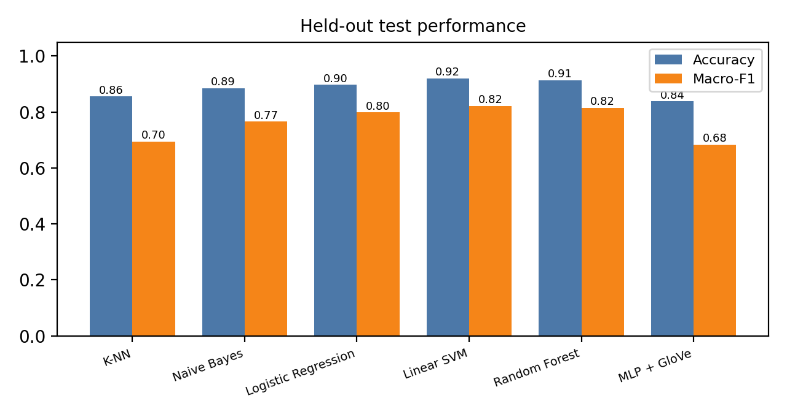
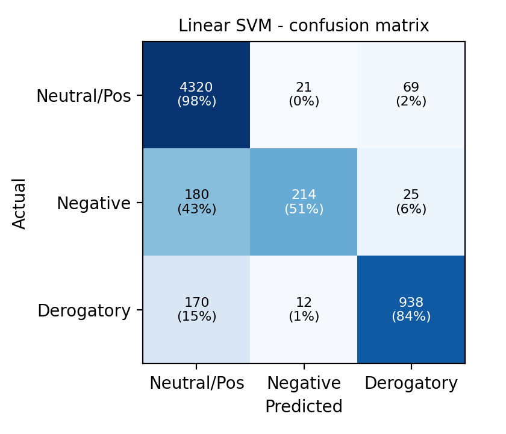

# 🎮 Trolls, Haters, or Teammates
### Classifying Sentiment in the Language of PvP Game Communications

**Course:** UE24CS352A – Machine Learning Mini-Project
**Team:** Vaishnavi (PES1UG24CS514) · Yuvraj Pateria (PES1UG24CS547)

Competitive online games depend on fast text chat, but the same word can be friendly or hostile
("gg" after a win vs. "gg ez trash team"). This project classifies each PvP chat message into one of
three classes, following the setup of the Stanford CS229 report of the same name (Borst, Yang & Zhu, 2021):

| Class | Meaning | Example |
|---|---|---|
| **Neutral / Positive** | ordinary or friendly chat | "gg wp", "mid is open" |
| **Negative attitude** | subtle hostility, mockery, blame | "did you buy an account?" |
| **Derogatory** | explicit insults and slurs | "you are trash, uninstall" |

We compare six classifiers on TF-IDF and GloVe features and ship an interactive Streamlit demo.

| | |
|---|---|
| **Deployed model** | TF-IDF (word + character n-grams) → Linear SVM (probability-calibrated) |
| **Test accuracy / macro-F1** | **92.0 % / 0.822** on 5,949 unseen Dota 2 chat messages |
| **Inference speed** | ≈ 2.2 ms per message on CPU (including vectorisation) |

---

## Results

Evaluated once on a held-out split that is never used for training or tuning.

| Model | Features | Accuracy | Macro-F1 | Negative-attitude F1 | ms / msg |
|---|---|---|---|---|---|
| K-NN | TF-IDF | 0.856 | 0.695 | 0.51 | 29.2 |
| Naive Bayes | TF-IDF | 0.885 | 0.765 | 0.56 | 1.5 |
| Logistic Regression | TF-IDF | 0.897 | 0.799 | 0.59 | 1.4 |
| **Linear SVM** (deployed) | TF-IDF | **0.920** | **0.822** | **0.64** | **2.2** |
| Random Forest | TF-IDF | 0.914 | 0.815 | 0.64 | 10.1 |
| MLP + GloVe | GloVe-50 (avg.) | 0.838 | 0.683 | 0.53 | 0.2 |




**What the results show**

- **TF-IDF beats pre-trained embeddings.** Linear SVM is the strongest model, while the GloVe network is among the weakest
  (macro-F1 0.68). GloVe was trained on news text and covers only 87 % of the word tokens here, so much gamer slang
  is invisible to it. TF-IDF learns directly from the chat. The Stanford paper argues the same.
- **Negative attitude is the hard class** (F1 0.64). It is rare (1,140 training messages) and differs from neutral chatter in tone
  rather than vocabulary: 43 % of negative-attitude messages are predicted as Neutral / Positive.
  Derogatory messages are easier (F1 0.87) because they contain recognisable insults.
- **Speed vs. accuracy.** Random Forest is close in accuracy but ≈ 4× slower per message than the
  SVM; K-NN is ≈ 13× slower and also trails in accuracy; it must compare every query against all training messages.
  (K-NN's best *k* sat at the top of our search grid, a sign it drifts towards the majority class.)
- **Leakage check.** 12.6 % of test messages (mostly short ones like "gg") also occur verbatim in the training set.
  On the remaining *novel* messages the deployed model scores 91.7 % accuracy / 0.815 macro-F1,
  so the headline number is not inflated by duplicates.

---

## Dataset

[**CONDA**](https://github.com/usydnlp/CONDA) (Weld et al., ACL 2021): ~45k utterances from Dota 2
match chat, annotated by humans. It is downloaded automatically on first run. The official test file is
unlabelled, so we train on `CONDA_train` and test on `CONDA_valid`.

> ℹ️ The Stanford paper used its own hand-labelled DOTA 2 + League of Legends chats (33k messages),
> which are not available to us. CONDA is the closest public substitute, and its annotations are mapped
> onto the paper's three classes as follows. This is an **approximation**, not the same labelling.

| Our class | CONDA intent class | Train / Test messages |
|---|---|---|
| **Neutral / Positive** | `O` (other chatter) | 12,552 / 4,410 |
| **Negative attitude** | `I` (implicit toxicity) | 1,140 / 419 |
| **Derogatory** | `E` (explicit toxicity) | 3,220 / 1,120 |
| *(dropped)* | `A` (action requests – ambiguous) | – |

All three labels are human annotations (no rule-derived labels). Preprocessing (`src/preprocess.py`): lower-casing,
removing CONDA's `[SEPA]` markers, collapsing repeated characters ("soooo" → "soo"), URL masking,
whitespace cleanup, de-duplication within each split.

## Method

1. **TF-IDF features** – word 1–2-grams (captures "gg ez") plus character 2–5-grams (robust to typos and leetspeak),
   27,956 features; single-character tokens such as "u" are kept.
2. **GloVe features** – each message is the average of the 50-d GloVe vectors of its words (out-of-vocabulary slang is ignored).
3. **Classifiers** – K-NN (cosine), Multinomial Naive Bayes, Logistic Regression, Linear SVM (probability-calibrated),
   Random Forest, and a feedforward network (MLP) on GloVe. Linear models and forests use class-balanced weights.
4. **Protocol** – hyper-parameters are tuned on a stratified 15 % validation split; final models are refit on all training data and scored once on the test split.
5. **Deployment** – the best probability-producing TF-IDF model by validation macro-F1 is saved to `models/model.pkl`
   (with `models/vectorizer.pkl`) and served by `demo.py`.

---

## Project structure

```
├── demo.py                  # Streamlit app (live demo, results tab, about tab)
├── train_model.py           # one-command training entry point
├── requirements.txt         # core dependencies
├── requirements-lstm.txt    # + PyTorch for the optional Bi-LSTM
├── src/
│   ├── config.py            # paths, labels, URLs, seed
│   ├── preprocess.py        # text cleaning + CONDA → 3-class mapping
│   ├── data.py              # download + build processed train/test CSVs
│   ├── features.py          # TF-IDF vectoriser
│   ├── glove.py             # GloVe download + averaged-embedding features
│   ├── train_baselines.py   # all six models, tuning, model selection, plots
│   ├── train_lstm.py        # optional Bi-LSTM + GloVe (PyTorch, not run for this report)
│   └── evaluate.py          # metrics, latency, plots
├── data/                    # raw/ and processed/ CSVs (created on first run)
├── models/                  # model.pkl, vectorizer.pkl, metrics_baselines.json
├── notebooks/               # exploratory analysis & results walkthrough
└── docs/                    # 2-page report (PDF) and figures
```

## Run it

```bash
# 1. Install
python -m venv .venv && source .venv/bin/activate      # Windows: .venv\Scripts\activate
pip install -r requirements.txt

# 2. Train (downloads CONDA + GloVe ~70 MB, ~5-8 min on CPU) – regenerates models/ and docs/figures/
python train_model.py

# 3. Launch the demo
streamlit run demo.py
```

The repository already contains trained files in `models/`, so step 3 works immediately. If scikit-learn
prints an `InconsistentVersionWarning` when loading them, just re-run step 2 on your machine.

Optional Bi-LSTM (not part of the reported results): `pip install -r requirements-lstm.txt && python train_model.py --lstm`

## Limitations & future work

- Dota 2 chat only; other games use different slang. The labels approximate the paper's, so numbers are not directly comparable to it.
- Sarcasm and conversational context are hard for bag-of-n-gram models (e.g. "wow what a great play genius" is read as friendly). Adding preceding messages as context
  (CONDA provides them) or fine-tuning a transformer is the natural next step.
- Negative attitude is under-detected; more labelled examples or cost-sensitive thresholds would help.
- Moderation decisions should keep a human in the loop – this is a triage tool, not a judge.

## References

- Borst, K., Yang, T., Zhu, M. (2021). *Trolls, Haters, or Teammates: Classifying Sentiment in the Language of PvP Game Communications.* Stanford CS229 project report.
- Weld, H. et al. (2021). *CONDA: a CONtextual Dual-Annotated dataset for in-game toxicity understanding and detection.* ACL-IJCNLP Findings.
- Pennington, J., Socher, R., Manning, C. (2014). *GloVe: Global Vectors for Word Representation.*
